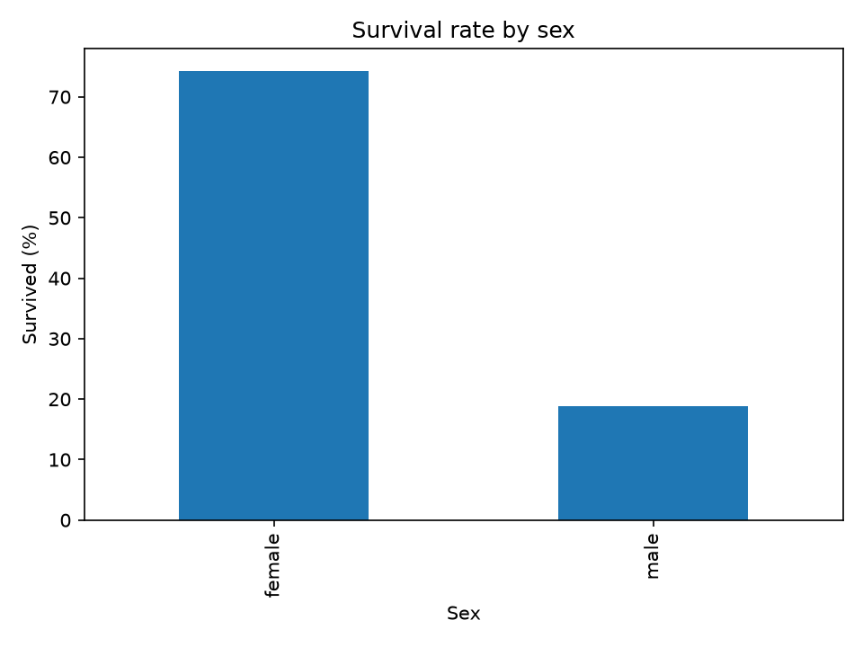
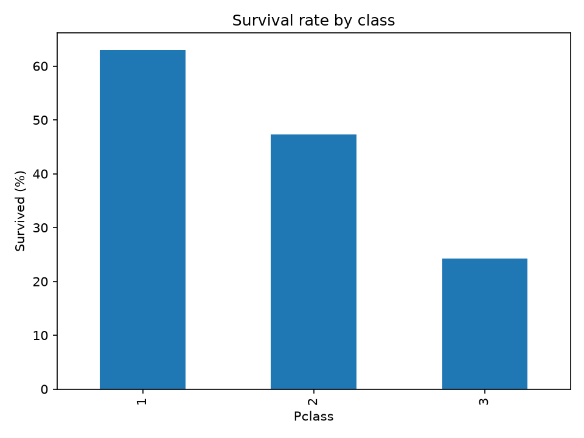
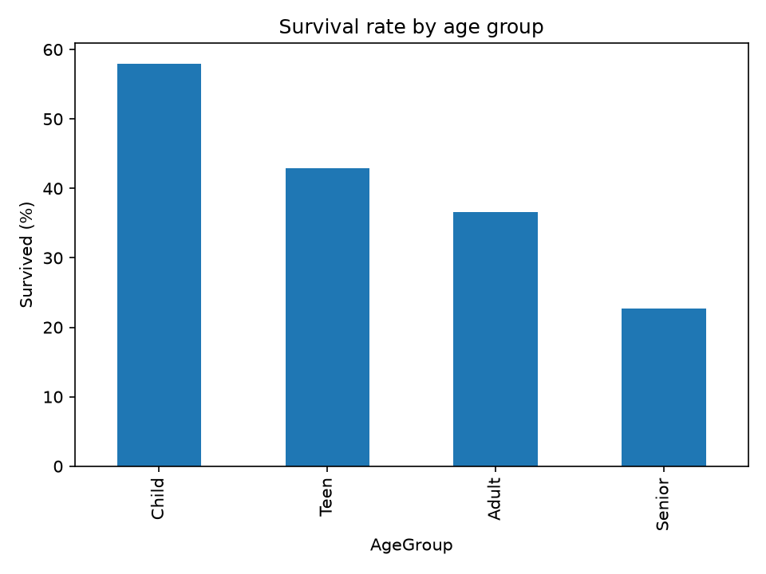

# Titanic Survival Analysis

Cleaned the Titanic passenger data with Python (pandas, matplotlib)
and answered 5 questions about who survived.

## Findings
- Overall survival rate: 38.4%
- Sex: female 74.2%, male 18.9%
- Class: 1st 63.0%, 2nd 47.3%, 3rd 24.2%
- Age group: Child 58.0%, Teen 42.9%, Adult 36.6%, Senior 22.7%
- Median fare: class 1 60.29, class 2 14.25, class 3 8.05
- Survivors paid a median fare of 26.00, compared with 10.50 for those who died.

## Cleaning decisions
- Cabin: 77% missing (687 of 891), too sparse to fill. I kept a HasCabin
  flag (True/False) and dropped the original column.
- Embarked: 2 values missing, filled with the most common port (Southampton).
- Age: 177 values missing, filled with the median age of the same sex and
  class. Median age differs by class (about 37, 29 and 24), so a group
  median is more realistic than one overall number.

## How to run
1. Download titanic.csv from https://github.com/datasciencedojo/datasets
   and put it in a folder named data/
2. Install the libraries: pip install -r requirements.txt
3. Run: python analysis.py

## Charts

